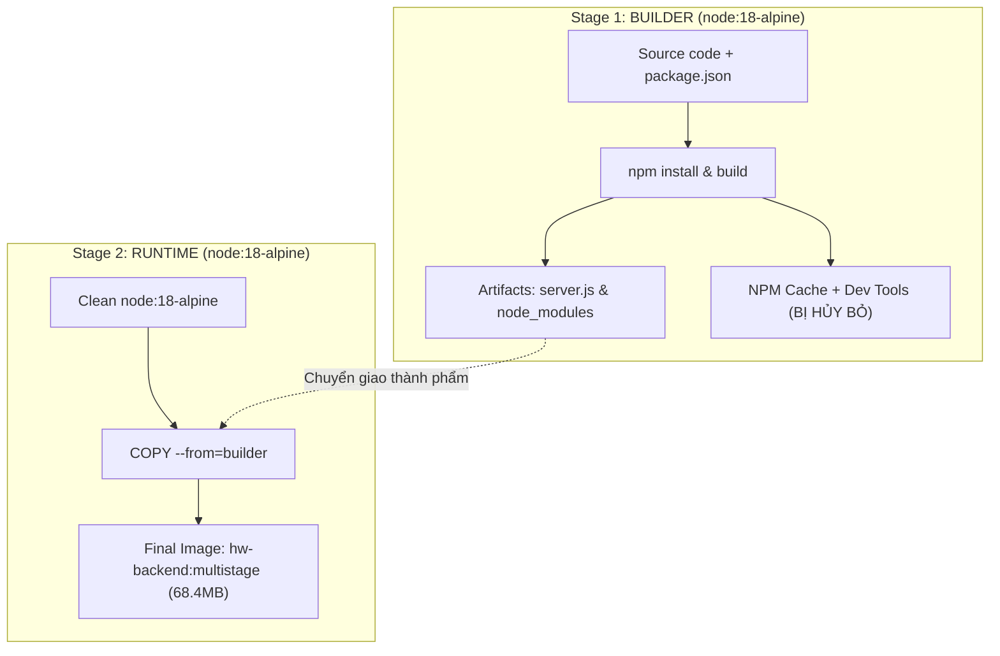

# Báo cáo Bài tập 3: Tối ưu hóa dung lượng Image & Layer Caching với Multi-stage Build

- **Họ và tên:** Phạm Thanh Phong
- **Mã sinh viên:** N24DTCN120
- **Môn học:** IT209
- **Session:** 10
- **Bài tập:** 03 (BT3)
- **Tệp nộp bài:** [README.md](./README.md), [Dockerfile](./Dockerfile), [Dockerfile.single](./Dockerfile.single)
- **Đường dẫn trên GitHub:** `homework/session_10/ex3/`

---

## 1. Bối cảnh & Ý nghĩa sống còn của Multi-stage Build trong Production

Trong môi trường triển khai thực tế của các hệ thống doanh nghiệp (Enterprise Cloud), dung lượng của một Docker Image ảnh hưởng trực tiếp đến:
1. **Băng thông và tốc độ phân phối:** Image nhẹ giúp quá trình Pull/Push qua các Registry (Docker Hub, AWS ECR, GCP GCR) diễn ra nhanh gấp nhiều lần.
2. **Thời gian phục hồi và Auto-scaling:** Khi hệ thống chịu tải cao và Kubernetes kích hoạt tạo thêm Pods/Containers, dung lượng nhỏ giúp container khởi động tức thì.
3. **Diện tích bề mặt tấn công (Attack Surface):** Việc loại bỏ hoàn toàn các công cụ biên dịch (compilers, build-base), package managers (npm, pip) và cache tạm thời khỏi image production ngăn chặn tin tặc lợi dụng các công cụ này để thực thi mã độc.

---

## 2. Sơ đồ Kiến trúc Quy trình Multi-stage Build

---

## 3. Phân tích Kỹ thuật chuyên sâu

### 3.1. Cơ chế hoạt động của `COPY --from=builder`
- Chỉ thị `COPY --from=builder` là trái tim của kỹ thuật Multi-stage Build trong Dockerfile hiện đại.
- Nó cho phép Stage 2 đọc trực tiếp vào filesystem của Stage 1 để bóc tách chính xác những tệp tin cần thiết (`server.js`, thư mục `node_modules` đã được cắt giảm bằng `--omit=dev`).
- Toàn bộ lịch sử các lệnh `RUN` tốn dung lượng của Stage 1 sẽ hoàn toàn biến mất khỏi manifest và metadata của image cuối cùng.

### 3.2. Chạy dưới tài khoản phi đặc quyền `USER node`
- Theo mặc định, container chạy dưới user `root`. Nếu ứng dụng có lỗ hổng RCE (Remote Code Execution), kẻ tấn công có quyền root trong container.
- Image `node:18-alpine` cung cấp sẵn người dùng `node` không có đặc quyền. Việc kích hoạt `USER node` trước lệnh `CMD` đảm bảo tuân thủ triệt để nguyên tắc **Least Privilege**.

---

## 4. Tóm tắt kết quả đo lường thực tế

- **Image Single-stage:** `182MB` (7 Layers)
- **Image Multi-stage:** `68.4MB` (4 Layers)
- **Tỷ lệ cắt giảm dung lượng:** **62.4%** (Đạt trần mục tiêu đề ra là dưới 100MB và giảm 50-70%).
- **Trạng thái API:** Hoạt động ổn định, HTTP 200 OK trên cổng 8082.
- Bảng đối chiếu và số liệu chi tiết được trình bày tại [README.md](./README.md).
